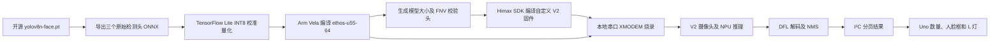

# Grove Vision AI V2 + Arduino Uno：本地开源人脸检测工作流

将开源 `yolov8n-face` 模型部署到 **Grove Vision AI V2**，由 V2 的摄像头和 NPU 完成人脸检测，再通过 I²C 把人脸数量、位置、尺寸和置信度传给 **Arduino Uno R3**。Uno 在检测到人脸时点亮自带的 L 灯。

这里实现的是**人脸检测**，输出人脸框，不识别姓名或身份。部署、转换、编译和烧录不需要 Seeed 网页、账号或模型库；摄像头和芯片驱动仍使用固定版本的 Himax SDK。

仓库包含整个工作流的源码、固定版本配置、预训练权重、中间模型、已验证的固件、环境准备脚本、烧录工具和实机验证记录。约 6.6 GB 的本机虚拟环境、工具解压目录、缓存及私人摄像头照片保留在本地；GitHub 克隆后通过准备脚本重建依赖。原来的私人校准图片不随仓库分发，因此重新量化的文件不保证与提交的基线模型逐字节一致。

## 目录

- [实测结果与边界](#实测结果与边界)
- [硬件与接线](#硬件与接线)
- [快速开始：使用已验证产物](#快速开始使用已验证产物)
- [完整复现：从权重生成模型和固件](#完整复现从权重生成模型和固件)
- [串口和 I²C 数据格式](#串口和-i²c-数据格式)
- [算法与内存](#算法与内存)
- [文件说明](#文件说明)
- [故障排查](#故障排查)
- [验证与持续集成](#验证与持续集成)
- [依赖和许可](#依赖和许可)

## 实测结果与边界

2026-10-10 完成实物联调，最终使用 Uno USB 给两块板供电，V2 USB 断开。

| 项目 | 实测结果 |
|---|---|
| V2 模型完整性 | 2,778,912 字节，FNV32 `2f1a734b` 匹配 |
| NPU 工作内存 | 实测 tensor arena 300,684 字节 |
| V2 独立检测 | 对着人脸的 147 帧中，139 帧为 1 张脸，5 帧为 2 张脸，启动阶段 3 帧为 0 |
| Uno 读取有脸画面 | 连续 36 次 `COUNT=1`，帧号 103→245，人脸框随移动变化 |
| Uno 读取无人脸画面 | 连续 36 次 `COUNT=0`，帧号 484→625 |
| Uno L 灯 | 已目视确认有脸时亮起；无人脸时熄灭没有单独目视确认 |
| Uno 编译 | Flash 5,064 / 32,256 字节；RAM 535 / 2,048 字节 |
| 数据停滞保护 | 超过两秒无新帧时输出 `WAIT_V2_STALE` 并熄灭检测灯 |

证据见 [验证摘要](face_detection/evidence/verification.json)、[有脸串口记录](face_detection/evidence/uno-face-present.log)、[无人脸记录](face_detection/evidence/uno-no-face.log)和[停滞保护记录](face_detection/evidence/uno-stale-guard.log)。这些记录只包含检测结果，没有照片。

这是一套已经跑通的原型，不是完整准确率评测。少数帧中的额外人脸框是否为误检尚未确认；192×192 输入对远处的小脸可能漏检；最多输出 16 张脸。先在充足室内光线、约 30～60 cm 距离下检查基本功能。

仓库保存两个 V2 固件：

| 文件 | 状态 | 默认使用 |
|---|---|---|
| `artifacts/v2-face-tested.img` | 已实际烧录，并与提交的 Vela 模型完成上述实机测试 | 是 |
| `artifacts/v2-face-rebuilt.img` | 迁移工程后重新编译成功，尚未重新烧录验证 | 否 |
| `artifacts/uno-face.hex` | 当前 Uno 读取程序，包含数据停滞保护，已烧录验证 | Uno 产物 |

上表路径相对于 `face_detection/`。两份 V2 固件的 SHA256 不同，不能用编译成功代替实机验证；详细校验值在 [manifest.json](face_detection/manifest.json)。

## 硬件与接线

- Grove Vision AI **V2** 一块，本工程不适用于 V1。
- Arduino Uno R3 一块，本次验证使用 ATmega328P。
- 已安装摄像头，本次识别到的摄像头为 OV5647。
- V2 USB-C 数据线、Uno USB 数据线、Grove 四线或相应转接线。
- Windows 64 位电脑；重新编译 V2 的流程针对 Windows。

**烧录 V2 时**：V2 USB-C 直连电脑，断开 Grove 线。

**正常运行时**：先断开两块板的 USB，接好以下四根线；只接 Uno USB，V2 USB 保持断开。

| V2 Grove 线 | 功能 | Uno R3 引脚 |
|---|---|---|
| 黄色 | SCL，I²C 时钟 | A5 / SCL |
| 白色 | SDA，I²C 数据 | A4 / SDA |
| 红色 | 电源 | 5V |
| 黑色 | 地 | GND |

如要用两根 USB 同时读取两块板的串口，联调时只接 SDA、SCL、GND，断开红色 VCC，避免把两个供电输出接在一起。按丝印核对功能，不能只依赖线的颜色。

Uno 上的 **A4/A5 是 I²C 引脚**；数字 0/1 是串口 RX/TX。`LED_BUILTIN` 在 Uno R3 上对应 D13，自带 L 灯。本工程的 I²C 接线不使用 D0、D1 或 D13。

## 快速开始：使用已验证产物

所有命令都在仓库根目录运行。下面的 COM10、COM11 是本次设备的串口号，在其他电脑上要替换为实际值。

### 1. 克隆并校验

```powershell
git clone https://github.com/MIke-Slim/grove-vision-ai-v2-face-detection.git
cd grove-vision-ai-v2-face-detection
py -3.11 face_detection/tools/verify_artifacts.py
```

私有仓库需要使用有权限的 GitHub 账号登录。首次校验会逐个检查已提交模型和固件的大小、SHA256。

### 2. 准备 Python 环境

使用 **Python 3.11 64 位**。已有 PlatformIO 的用户也可以指定其 Python，准备脚本会优先探测 `%USERPROFILE%/.platformio/penv/Scripts/python.exe`。

```powershell
$BasePython = py -3.11 -c "import sys; print(sys.executable)"
& face_detection/tools/setup.ps1 -Mode Flash -Python $BasePython
& $BasePython -m pip install platformio==6.2.0
```

`Flash` 模式只准备烧录和串口所需的 `.vela-venv`，无需下载整个 SDK、Arm 编译器或 PyTorch。首次准备需要联网下载安装依赖，之后设备推理在 V2 上完成。

如果 PowerShell 阻止运行本仓库脚本，可以仅在当前窗口临时设置：

```powershell
Set-ExecutionPolicy -Scope Process Bypass
```

### 3. 检查 V2 文件并烧录

V2 USB-C 直连电脑，先断开 Grove 接线。关闭占用该串口的串口监视器。

```powershell
& face_detection/.vela-venv/Scripts/python.exe -m serial.tools.list_ports -v
& face_detection/.vela-venv/Scripts/python.exe face_detection/tools/flash_v2.py --port COM11 --dry-run
& face_detection/.vela-venv/Scripts/python.exe face_detection/tools/flash_v2.py --port COM11
```

默认烧录 `v2-face-tested.img` 和提交的 Vela 模型。`--dry-run` 不打开设备，只检查输入文件、基线配对和 Flash 分区范围。工具通过串口复位进入引导程序，分成 256 KiB 段传输模型，并补偿串口发送节奏。整次传输超时会终止工具创建的进程。

完成传输后，启动日志应出现：

```text
FACE_MODEL bytes=2778912 checksum=2f1a734b expected=2f1a734b
FACE_READY arena_used=300684 input_scale_x1e6=3921 zero=-128
FACE_INIT done
FACE_FRAME ... state=1
```

模型完整性匹配并开始输出新帧，才说明运行成功。`TRANSFER_COMPLETE` 只表示传输流程完成。

### 4. 单独检查 V2 检测

```powershell
& face_detection/.vela-venv/Scripts/python.exe face_detection/tools/monitor_v2.py --port COM11 --seconds 20
```

打开 V2 USB 串口会复位设备。启动后面对摄像头，观察 `FACE_FRAME` 数量和 `FACE_BOX`；移动头部时框应更新，离开画面时数量应归零。日志保存在本地 `face_detection/logs/`。

### 5. 编译并上传 Uno

先只把 Uno USB 接入电脑，暂时断开 Grove 线。确认端口后上传：

```powershell
& $BasePython -m platformio run -d face_detection/uno
& $BasePython -m platformio run -d face_detection/uno -t upload --upload-port COM10
```

`face_detection/uno/platformio.ini` 的 `upload_port` 和串口读取工具默认值可以修改。仓库根目录的 `src/main.cpp`、`platformio.ini` 是原先的 LED 闪烁工程；人脸读取程序必须使用 `-d face_detection/uno`。

### 6. 接线并验证整条链路

按上面的表连接 Grove 四根线，只保留 Uno USB 供电，再读取 Uno：

```powershell
& face_detection/.vela-venv/Scripts/python.exe face_detection/tools/monitor_uno.py --port COM10 --seconds 20
```

有脸时应出现类似：

```text
FRAME=103 COUNT=1 IMAGE=320x240
FACE 0 x=98 y=93 w=107 h=75 score=84
```

无人脸时应出现 `COUNT=0`。确认帧号持续变化，再观察 Uno 的 L 灯。若切换供电后帧号停住，先按 V2 RESET，检查是否恢复；本次实测曾通过该操作恢复。

## 完整复现：从权重生成模型和固件



### 1. 准备全部依赖

需要 Git for Windows、Windows 自带的 `tar.exe` 和空闲的 `T:` 驱动器名。

```powershell
& face_detection/tools/setup.ps1 -Mode Full -Python $BasePython
```

该步骤建立三个隔离环境，并恢复被 `.gitignore` 排除的 SDK、Arm 工具链、GNU make 和目录链接。

| 环境 / 工具 | 固定版本或参数 | 用途 |
|---|---|---|
| `.venv` | PyTorch 2.2.2+cpu、torchvision 0.17.2+cpu、Ultralytics 8.0.173 | 导出 ONNX、电脑检测 |
| `.convert-venv` | TensorFlow Intel 2.13.1、onnx2tf 1.15.4、ONNX 1.15、onnxruntime 1.16.3 | 转换及 INT8 量化 |
| `.vela-venv` | ethos-u-vela 4.0.1、pyserial 3.5、xmodem 0.4.7 | NPU 编译、烧录、串口 |
| Arm GNU | 13.2.Rel1，Windows mingw-w64-i686 arm-none-eabi | 编译 V2 固件 |
| GNU make | MSYS2 mingw-w64-x86_64-make 4.4.1-3 | SDK 构建 |
| Himax SDK | `d3265e20d75fe20faccbf185d24454ad08b2fda8` | 芯片、摄像头和 TFLM 驱动 |
| PlatformIO | 6.2.0；Uno atmelavr | Uno 编译、上传 |

三个 `requirements-*-lock.txt` 保存本次使用的版本快照。SDK 提交、下载地址、工具链压缩包的校验值在 [sources.lock.json](face_detection/sources.lock.json)。SDK ZIP 的提交标记及两个基线文件的 SHA256 也会核对，避免悄悄使用变化后的 `main`。

`-Offline` 只适合环境已经安装好且缓存齐全的机器：它跳过 pip 安装并使用已有压缩包，不会把空环境自动变为可用环境。

### 2. 准备自己的校准和测试图片

把一张确认含人脸、用于正向检测测试的图片放到 `face_detection/data/face.jpg`；可将额外的多光线、多距离图片放到 `face_detection/data/camera-calibration/*.jpg`。这些文件只保存在本地。

已提交的基线模型最初使用 90 个社区示例图裁剪、曝光变体及 24 张本地摄像头图片，共 114 个样本进行校准。仓库不分发这批照片，提交的最终模型和已验证固件可直接使用。换用自己的校准图会产生新的 INT8 数值和校验值，需要重新编译对应固件。

```powershell
& face_detection/.venv/Scripts/python.exe face_detection/tools/validate_model.py
& face_detection/.venv/Scripts/python.exe face_detection/tools/export_raw_heads.py
```

也可以给两条命令同时传入相同的 `--image PATH`。第一步产生检测框记录，第二步用这些框构建裁剪和曝光校准样本；测试图应确实包含人脸。该样本生成器用于基本功能验证，不代替覆盖真实场景的数据集建设。

### 3. 转换和验证量化模型

```powershell
& face_detection/.convert-venv/Scripts/python.exe face_detection/tools/convert_tflite.py
& face_detection/.convert-venv/Scripts/python.exe face_detection/tools/validate_quantization.py --images face_detection/data/face.jpg
```

转换器会在本地完成 ONNX 简化、合法化节点名、生成 Keras 模型和严格 INT8 TFLite。校准输入为 RGB 浮点 `[0,1]`，输入输出都采用 INT8。量化比较在电脑端运行普通 TFLite，不运行已经带 Ethos-U 自定义算子的 Vela 文件。

### 4. 编译 NPU 模型

```powershell
& face_detection/.vela-venv/Scripts/vela.exe `
  --accelerator-config ethos-u55-64 `
  --config face_detection/tools/himax_vela.ini `
  --system-config My_Sys_Cfg `
  --memory-mode My_Mem_Mode_Parent `
  --output-dir face_detection/models/vela `
  face_detection/models/tflite/face-192_full_integer_quant.tflite
```

本次基线为 234/234 算子分配到 NPU，没有 CPU 算子。这个分配结果不是实测帧率，修改模型后要重新检查 Vela 报告。

### 5. 编译 V2 固件

```powershell
& face_detection/tools/build_firmware.ps1
& face_detection/.vela-venv/Scripts/python.exe face_detection/tools/verify_artifacts.py
```

准备脚本复制原 SDK 示例为 `tflm_yolov8_face`，覆盖检测、旋转补偿、后处理及 I²C 接口，并生成当前模型的大小与 FNV 校验头。构建脚本使用临时 `T:` 映射处理 Windows 长路径，自动寻找 Git for Windows 的运行时 DLL，编译并打包 `output.img`，最后更新 `artifacts/v2-face-rebuilt.img` 与校验清单。

只保留一个供编译使用的 `*_vela.tflite`；不要把其他实验模型同时放入 `models/vela/`。`T:` 若已指向其他目录，脚本会报错，不会覆盖。正常结束或失败退出后会撤销本次创建的映射。

### 6. 烧录新构建的固件与新模型

```powershell
& face_detection/.vela-venv/Scripts/python.exe face_detection/tools/flash_v2.py `
  --port COM11 --firmware face_detection/artifacts/v2-face-rebuilt.img --dry-run
& face_detection/.vela-venv/Scripts/python.exe face_detection/tools/flash_v2.py `
  --port COM11 --firmware face_detection/artifacts/v2-face-rebuilt.img
```

Flash 偏移为 `0xB7B000`，固件读取的映射地址为 `0x3AB7B000`。如果只换模型而没有重新编译固件，模型完整性检查会阻止推理。保留 `v2-face-tested.img` 作为已验证基线，默认烧录工具会拒绝把改变后的模型与该基线错误配对。

新模型要重新做有脸、无人脸、帧号更新、I²C 接收及 LED 实物测试。与基线模型相比，不能只凭一次电脑预测或编译通过判断设备部署成功。

## 串口和 I²C 数据格式

### V2 USB 串口

921600 波特率，输出：

```text
FACE_FRAME <帧号> <人脸数量> <图像宽度> <图像高度> state=<状态>
FACE_BOX <帧号> <人脸索引> <x> <y> <宽度> <高度> <置信度百分比>
```

`x,y` 是左上角，单位像素，坐标对应原始 **320×240** 摄像头画面，已经反向补偿了推理时的旋转。置信度百分比不是检测准确率。

### Uno USB 串口

115200 波特率，每约 500 ms 汇报一个完整接收结果：

```text
FRAME=<帧号> COUNT=<数量> IMAGE=<宽>x<高>
FACE <索引> x=<x> y=<y> w=<宽> h=<高> score=<百分比>
```

### I²C 协议

V2 从机地址 `0x62`，Uno 使用 100 kHz，读事务固定 **32 字节**。所有 `uint16` 为小端序。

| 字节 | 内容 |
|---|---|
| 0～1 | ASCII `FD` |
| 2 | 协议版本，当前为 1 |
| 3 | 状态：0 初始化，1 就绪，2 错误 |
| 4～5 | 16 位帧号，会回绕 |
| 6 | 总人脸数，0～16 |
| 7 | 当前页号，从 0 开始 |
| 8～9 | 原图宽度 |
| 10～11 | 原图高度 |
| 12～21 | 本页第 1 张脸 |
| 22～31 | 本页第 2 张脸 |

每张脸占 10 字节：`x:uint16, y:uint16, w:uint16, h:uint16, score:uint8, class:uint8`，当前类号为 0。每页两张脸，最多 8 页；无人脸时仍有一页。Uno 根据帧号和页号收齐同一帧，避免拼接不同帧的数据。

## 算法与内存

- 输入：NHWC RGB `[1,192,192,3]`，INT8，scale 约 `1/255`、zero point `-128`。
- 原权重包含 5 个关键点；导出脚本只使用 `cv2` 框回归头和 `cv3` 分类头，去掉关键点输出。
- 三个原始头：NCHW `[1,65,24,24]`、`[1,65,12,12]`、`[1,65,6,6]`；TFLite 输出为 NHWC，输出顺序可能改变，代码按形状识别。
- 65 个通道 = 4×16 个 DFL 回归值 + 1 个人脸类别值。
- DFL 使用 softmax 求距离期望；类别使用 sigmoid；阈值 0.35。
- NMS IoU 阈值 0.45；候选最多 128，最终最多 16 张脸，按置信度选取。
- 当前摄像头安装方向需要输入顺时针旋转 90°；代码在原输入缓冲区内旋转，然后把输出框转换回原图坐标。
- 固件预留 arena 为 1053 KiB，实测使用 300,684 字节。这不等于全系统总内存占用。

调整摄像头安装方向时检查 `firmware/face_inference.cpp` 的 `kRotateClockwise`。调整输入大小、检测头、阈值或模型地址时，需要一起检查导出、Vela 编译、固件解码和校验头。

## 文件说明

```text
.
├─ README.md                         完整使用及复现流程
├─ THIRD_PARTY.md                    上游来源与许可
├─ .github/workflows/verify.yml      文件校验、Python 语法和 Uno 编译
├─ src/ + platformio.ini             原始 LED 闪烁工程
├─ diagnostics/                     早期端口和 I²C 排查工具
└─ face_detection/
   ├─ firmware/face_inference.cpp    V2 推理、DFL、NMS、旋转和 I²C
   ├─ uno/                          Uno 独立 PlatformIO 工程
   ├─ tools/                        准备、转换、编译、烧录和读取工具
   ├─ models/                       原始权重、ONNX、普通 TFLite 和 Vela 模型
   ├─ artifacts/                    已验证/重建固件及 Uno HEX
   ├─ evidence/                     不含照片的实机结果
   ├─ manifest.json                 产物校验值及模型配置
   ├─ sources.lock.json             SDK 和编译依赖的固定来源
   └─ requirements-*-lock.txt        Python 环境版本快照
```

本地另有被 Git 忽略的 `.venv`、`.convert-venv`、`.vela-venv`、`vendor`、`toolchains`、`sdk`、`tc`、`data`、`logs` 和缓存。GitHub 仓库不包含 ChatGPT 同步参考资料、迁移审计、本机绝对路径配置或个人照片。

`capture_calibration.py`、`inspect_device.py` 是替换前兼容 AT 指令固件的早期工具；当前自定义固件输出 `FACE_*`，不实现旧 `AT+SAMPLE`/`AT+MODEL` 接口。当前使用 `monitor_v2.py` 和 `monitor_uno.py` 检查结果。

## 故障排查

| 现象 | 检查和处理 |
|---|---|
| Uno USB 已插入但无串口 | 检查数据线；换电脑 USB 接口重新插拔。本次换接口后 COM10 恢复 |
| Uno 输出 `WAIT_V2` | 检查 V2 供电、共地、A4=SDA、A5=SCL，以及 V2 是否运行本工程固件 |
| Uno 输出 `WAIT_V2_STALE` | 总线上有有效包但帧号没变化；按 V2 RESET 后观察是否恢复。反复发生需继续诊断采集/推理/通信，不能算测试通过 |
| 有脸但一直为 0 | 检查光照、距离、摄像头排线及安装方向；当前基线要求顺时针旋转 90° 的推理补偿 |
| 报告 2 张脸但只有 1 人 | 查看额外框位置，检查背景人像及误检；不要仅因置信度高就认为一定正确 |
| `FACE_ERROR model incomplete` | 模型缺失、传输未完成或与固件不配对；重新检查 SHA256、完整传输及生成的 FNV 校验头 |
| 烧录停在模型传输 | 使用本工程的 256 KiB 分段和发送节奏；避免旧整文件/1 MiB 段发送方式 |
| 上传或监视器提示端口占用 | 关闭其他串口监视器；不要把蓝牙或其他 USB 设备当成 Uno |
| 编译找不到 `libintl-8.dll` | 使用 Git for Windows，确认 Git 命令对应安装目录内的 `mingw64/bin` 有运行时 DLL |
| T: 已占用 | 使用其他不占用 T: 的工作环境，或明确确认现有映射指向本工程后再构建 |
| 下载证书校验错误 | 核对系统时间与证书链，使用可信网络或已有校验通过的缓存；不关闭 TLS 校验 |
| 修改模型后仍默认烧录基线 | 新模型需要编译固件，并明确传 `--firmware face_detection/artifacts/v2-face-rebuilt.img` |

本次切换供电后曾停在帧号 1465，复位恢复，根因未确定。停滞检测能防止旧结果持续显示为实时状态，但不等于消除了导致停滞的问题。

## 验证与持续集成

```powershell
& $BasePython face_detection/tools/verify_artifacts.py
& $BasePython -m compileall -q face_detection/tools diagnostics
& $BasePython -m platformio run -d face_detection/uno
& face_detection/.vela-venv/Scripts/python.exe face_detection/tools/flash_v2.py --dry-run
```

GitHub Actions 校验已提交产物的 SHA256、Python 语法并编译 Uno。V2 重新编译通过本地 Windows 流程检查；物理摄像头、人脸场景、I²C 和 LED 测试需要连接实物，CI 不会宣称这些已验证。

## 依赖和许可

- 模型来源：[akanametov/yolo-face 1.0.0 权重](https://github.com/akanametov/yolo-face/releases/download/1.0.0/yolov8n-face.pt)。
- 芯片 SDK：[Himax 固定提交](https://github.com/HimaxWiseEyePlus/Seeed_Grove_Vision_AI_Module_V2/tree/d3265e20d75fe20faccbf185d24454ad08b2fda8)。
- 转换参考：[Himax YOLOv8_on_WE2](https://github.com/HimaxWiseEyePlus/YOLOv8_on_WE2)。
- Arm 编译器：[Arm GNU Toolchain](https://developer.arm.com/downloads/-/arm-gnu-toolchain-downloads)。

第三方项目各自保留其许可，详见 [THIRD_PARTY.md](THIRD_PARTY.md) 与 `licenses/`。本仓库没有把所有第三方代码和权重统一重新授权为 MIT。
